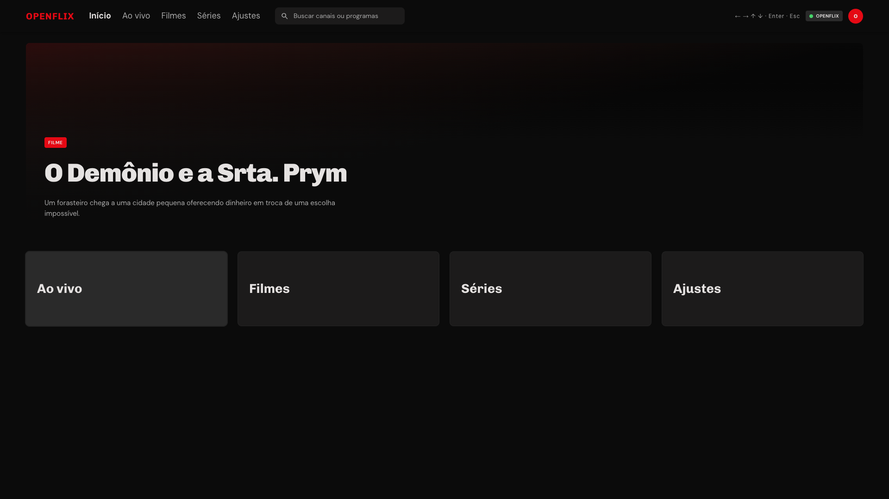

# OpenFlix

JS domain of a player for **your own** Xtream Codes (`player_api`) and M3U playlists. Architecture taken from the LIFE TV / FlexTV LiveStore APK. No VPN, MAC cloud, insecure TLS, or third-party catalog.

Target: Tauri 2 10-foot landscape shell (Dell). The core is testable without the UI today.



```bash
npm ci
npm test            # node --test + @faker-js/faker
npm run css         # Tailwind CLI → web/style.css (CRT tokens in web/input.css)
npm run ci          # css + prettier + lint + test
npm run dev         # css + http://127.0.0.1:8792/web/
npm run tauri:dist  # pack web/ + src/ into .tauri-dist (Tauri frontendDist)
npm run tauri:dev   # Tauri 2 window at 1920x1080 with the bundled front
npm run tauri:app   # package target-app/OpenFlix.app (release + ad-hoc codesign)
```

Repo: https://github.com/puppe1990/openflix

Reverse-engineering notes for the reference APK (protocol, obfuscation, endpoints):
[docs/reverse-engineering.md](docs/reverse-engineering.md).

10-foot home: **Live / Movies / Series / Settings**. Arrows and Enter. Local demo, no network.

On the Tauri app, playlists, favorites, and resume live in `life-tv.sqlite` (0600) in the app data directory. Xtream passwords stay in the `secrets.json` vault.

## In scope

- Xtream login (`user_info` / `server_info`)
- Portal → `get.php` / `player_api.php` / `live|movie|series`
- Local XC or M3U playlist (the original app's add-playlist MAC stays out)
- Catalog by category, M3U parse, adaptive MIME, resume, favorite, and lock

## Out of scope

- MAC phone-home, `libhax` / VPN, key dumps, streams that are not from the user's playlist
- Reusing art from the reference APK in the icon or the header
